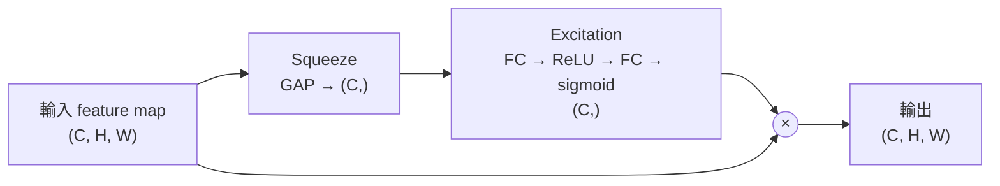
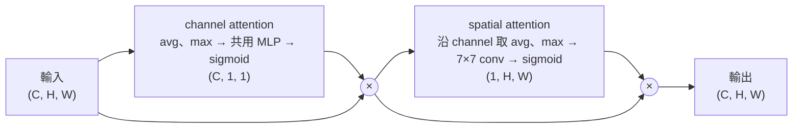
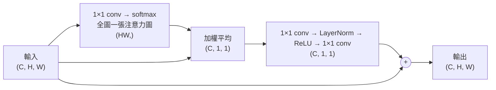
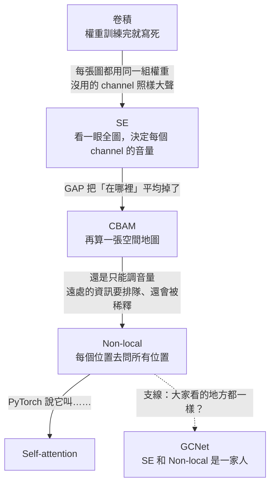

## 寫在前面<sub>（還是不想叫前言）</sub>

SE 叫注意力，CBAM 叫注意力，Transformer 裡面那個也叫注意力。

這幾個，是同一個東西嗎？

如果你學 CNN 的時候看過 SE、CBAM，後來又被 Transformer 那句 $\text{softmax}(QK^\top/\sqrt{d})\,V$ 砸過臉，你大概也冒出過這個問題：**名字一樣，長得完全不一樣，到底哪裡一樣？**

這篇就是要回答它。而且不是我直接告訴你答案而是你自己從 SE 一路往上推，推到最後，親手把 self-attention 做出來。

整篇其實只在問一件事：

> **權重是誰決定的？**

先把這個問題記著，每一節都會回來找它。

數學會有一點，但每一條式子，都會先算給你看。

### 你需要先會的東西

- **CNN**：conv、channel、feature map、pooling、ResNet 的殘差，你都看過，大概知道在幹嘛
- **PyTorch**：至少自己訓練過一個影像分類器
- **一點數學**：線性代數、矩陣乘法、內積，還有 softmax  <sub>或是報幹多的數學</sub>
- **環境**：裝好 NumPy、PyTorch 和 torchvision

不需要會任何一個注意力模組。~~因為這裡就是在教這個的~~。

### 前情提要

這篇的順序是**由簡到繁**：SE → CBAM → Non-local → self-attention，每一步只比上一步多一點點。

但這**不是歷史順序**。真正的歷史長什麼樣子，留到最後講。<sub>AI的發展史在這裡展現了抽象的發展</sub>

### 怎麼讀

- 這是**上篇**：CNN 裡的注意力，從 SE 一路推到 Non-local。**下篇**會把 self-attention 從 CNN 裡拿出來，一路講到 Transformer 和 ViT。
- 每一段程式碼都能直接跑，輸出都是真的跑出來的。標了「接續上面的程式」的，要接著前一段一起跑。
- 看不懂的地方，丟給 AI 問。~~這年頭學 AI 不用 AI，也太虧了~~  

**所以這個系列能叫 "AI從進階到被AI取代"**

---

## 卷積的權重是死的

先不要想注意力。我們來看一個你天天在用的東西：卷積。

卷積在幹嘛？你很熟：拿一個 kernel 在圖上滑，每個位置都跟附近的像素做加權和。

那：**那組權重是誰決定的？**

訓練決定的。

**訓練完之後呢？**

就固定了。

**看貓的時候用這組權重，看車的時候呢？**

同一組。

**看圖片左上角的時候用這組權重，看右下角的時候呢？**

還是同一組。

這件事理所當然到你可能從來沒認真想過它代表什麼。所以我們把它攤開來看。

### 卷積其實是一張表

為了讓表格印得下，先把圖片壓成一排 7 個像素，kernel 大小 3。

接下來做一件很蠢的事：**一次只動一個像素**——把第 $j$ 格設成 1、其他都是 0，丟進卷積，看它影響到哪些輸出、各乘上多少。7 格輪流戳一遍，就能拼出一張完整的表。

kernel 的權重故意設成 1、2、3，等一下比較好認：

```python
import torch
import torch.nn.functional as F

kernel = torch.tensor([[[1., 2., 3.]]])               # k=3，權重故意設成 1、2、3 方便認

n = 7
M = torch.zeros(n, n)
for j in range(n):
    x = torch.zeros(1, 1, n)
    x[0, 0, j] = 1                                    # 只戳第 j 格
    M[:, j] = F.conv1d(x, kernel, padding=1)[0, 0]    # 看它影響到哪些輸出、各乘上多少
print(M)
```

```
tensor([[2., 3., 0., 0., 0., 0., 0.],
        [1., 2., 3., 0., 0., 0., 0.],
        [0., 1., 2., 3., 0., 0., 0.],
        [0., 0., 1., 2., 3., 0., 0.],
        [0., 0., 0., 1., 2., 3., 0.],
        [0., 0., 0., 0., 1., 2., 3.],
        [0., 0., 0., 0., 0., 1., 2.]])
```

第 $i$ 列，就是 `output[i]` 的「配方」：它從每個 `input` 各拿多少。

看出來了嗎？**每一列都是同一組 1、2、3，只是往右挪了一格。**

`input[j]` 會被乘上多少，只看一件事：$j$ 在 $i$ 的哪一邊、隔幾格。左邊一格乘 1、自己乘 2、右邊一格乘 3，再遠就是 0。

寫成式子：

$$
\text{output}[i] = \sum_j w_{\,j-i}\; \text{input}[j]
$$

權重的下標是 $j - i$——**相對位置**。

那 `input[j]` 長什麼樣子呢？完全沒差。這張表是用「動一下」算出來的，我們根本還沒有餵任何一張圖。

拿兩張圖來試。接續上面的程式：

```python
torch.manual_seed(0)
for name in ["貓", "車"]:
    img = torch.randn(n)                                          # 隨便一張「圖」
    out = F.conv1d(img.view(1, 1, n), kernel, padding=1).view(n)
    print(f"{name}：卷積的輸出 跟 M @ 圖 的最大差距 = {(out - M @ img).abs().max().item()}")
```

```
貓：卷積的輸出 跟 M @ 圖 的最大差距 = 0.0
車：卷積的輸出 跟 M @ 圖 的最大差距 = 0.0
```

**貓用這張表，車也用這張表。** 卷積說穿了，就是把輸入乘上一張固定的表。

<sub>（真的 CNN 是二維的，而且有很多個 channel，表會大很多，但道理一模一樣：每個位置的配方都一樣，而且跟圖片無關。）</sub>

### 兩種「共用」

所以卷積的權重其實被共用了兩次：

| 共用 | 在表上長什麼樣子 | 結果 |
|:--|:--|:--|
| 跨**位置**共用 | 每一列都是同一組數字，只是挪了位置 | 平移等變：貓在左邊還是右邊，都用同一組權重去看（**好事**） |
| 跨**圖片**共用 | 整張表跟圖片無關 | 不管看到什麼，處理方式都一樣（**這篇要解決的事**） |

第一種共用是 CNN 這麼好用的原因之一，我們不動它。

問題出在第二種。

### 不會看情況

想像一個訓練好的 CNN，第 3 層有兩個 channel：一個對**毛**特別有反應，一個對**輪子**特別有反應。

現在餵它一張貓。

毛 channel 很開心地亮了。輪子 channel 也會有一點反應——但圖裡根本沒有輪子，它的反應全是誤判出來的雜訊。

下一層會把所有 channel 照固定的權重加起來，輪子 channel 的雜訊就這樣跟著被加進去了。換成一張車，就換毛 channel 在亂叫，下一層一樣照單全收。

你看得出來，「這張是貓，輪子 channel 先閉嘴」才是對的處理方式。但卷積做不到，因為**它的權重在看到這張圖之前就決定好了**。

<sub>（網路當然可以靠後面好幾層慢慢把雜訊抵銷掉，但那是在繞遠路。）</sub>

所以我們要的是：**先看一眼這張圖，再決定權重。**

寫成式子：

$$
w = f(x)
$$

權重不再是訓練完就寫死的常數，而是**輸入的函數**。換一張圖，權重就跟著換。

這個就是注意力。說穿了，它只做一件事：

> **讓權重由輸入自己決定。**

接下來你會看到好幾種叫「注意力」的東西：SE、CBAM、Non-local，最後是 Transformer 的 self-attention。它們看起來各不相同，但都在做這件事。

把它跟卷積擺在一起，就是這整篇最重要的一句話。我先講，後面你會一直看到它：

> 卷積的權重由**位置**決定，注意力的權重由**內容**決定。

順便把剛剛那張表記著。後面你會看到另一張表，長得跟它很不一樣：每一列都不同，而且每換一張圖，整張就重算一次。

那就從最簡單的開始：先看一眼整張圖，決定每個 channel 要開多大聲。

---

## 先看一眼，再決定誰大聲：SE 型注意力機制模組(SE模組)

剛剛的想法是「先看一眼這張圖，再決定每個 channel 開多大聲」。

把這句話拆開，剛好是三個步驟。

**第一步：看一眼整張圖。**

一個 channel 是一整張 $H \times W$ 的地圖。要「看一眼」，最簡單的方法就是把它**平均成一個數字**：這個 channel 在整張圖上平均有多亮。$C$ 個 channel，就得到 $C$ 個數字。

這就是 global average pooling（GAP），你在 ResNet 的最後面看過它。

**第二步：決定每個 channel 開多大聲。**

手上有 $C$ 個數字，要變成 $C$ 個音量。中間塞一個小小的 MLP：

FC（$C \to C/r$）→ ReLU → FC（$C/r \to C$）→ sigmoid

sigmoid 把每個音量壓在 0~1 之間：0 是靜音，1 是原音量。

**第三步：調音量。**

每個 channel 乘上自己的音量。整張 $H \times W$ 的地圖都乘同一個數。



這三步有名字：**Squeeze**（壓扁）、**Excitation**（激發）、**Scale**（縮放）。合起來就是 2017 年的 **SE（Squeeze-and-Excitation）**。

它拿下了 ILSVRC 2017 的分類冠軍（top-5 錯誤率 2.251%）。而 2017 年剛好是 ImageNet 競賽的最後一屆——SE 拿到的，是這個比賽最後一座分類冠軍。

寫成程式：

```python
import numpy as np

def sigmoid(z):
    return 1 / (1 + np.exp(-z))

def se_block(x, W1, W2):
    z = x.mean(axis=(1, 2))                   # Squeeze：(C, H, W) → (C,)，每個 channel 壓成一個數
    s = sigmoid(np.maximum(0, z @ W1) @ W2)   # Excitation：FC → ReLU → FC → sigmoid，得到 C 個音量
    return x * s[:, None, None], s            # Scale：每個 channel 乘上自己的音量

rng = np.random.default_rng(0)
C, H, W, r = 8, 8, 8, 2
W1 = rng.normal(0, 1, (C, C // r)) / np.sqrt(C)        # C → C/r（瓶頸）
W2 = rng.normal(0, 1, (C // r, C)) / np.sqrt(C // r)   # C/r → C

cat = rng.normal(0, 0.1, (C, H, W)); cat[:4] += 1      # 「貓」：前 4 個 channel（毛）反應很強
car = rng.normal(0, 0.1, (C, H, W)); car[4:] += 1      # 「車」：後 4 個 channel（輪子）反應很強

for name, img in [("貓", cat), ("車", car)]:
    _, s = se_block(img, W1, W2)
    print(f"{name}拿到的音量:", np.round(s, 2))
```

```
貓拿到的音量: [0.51 0.52 0.48 0.48 0.49 0.48 0.52 0.49]
車拿到的音量: [0.43 0.6  0.56 0.54 0.51 0.47 0.61 0.61]
```

同一個 SE、同一組 `W1` 和 `W2`，**兩張圖拿到的音量不一樣**。

（權重是隨機的、還沒訓練，所以現在是哪個 channel 被調大聲，還沒有意義。重點是：音量是**看了圖之後**才決定的。）

回頭看上一節那張表：卷積的權重，根本不用看圖就決定好了。

<sub>（SE 論文裡有一張很有趣的圖：淺層的 SE 不管看到什麼類別，給的音量都差不多；越往深層，不同類別拿到的音量就越不一樣。淺層的特徵大家都用得到，深層的特徵才開始分派系。）</sub>

### 為什麼中間要先縮小？

Excitation 那兩層 FC，中間先縮成 $C/r$ 再放大回來，是一個瓶頸。為什麼不直接一層 FC，$C \to C$ 就好？

兩個原因：

- **省參數**：一層 $C \times C$ 的 FC 要 $C^2$ 個參數；兩層夾瓶頸是 $2C^2/r$。論文預設 $r = 16$，$C = 256$ 的時候，從 65536 個降到 8192 個。
- **兩層中間夾一個 ReLU，才學得到 channel 之間比較複雜的關係**：「毛很亮、鬍鬚也很亮 → 那耳朵 channel 也開大聲一點」這種事，一層線性的 FC 做不來。

整個 SE 加進 ResNet-50，參數大約多 10%，計算量只多 0.26%。很便宜。

<sub>順帶一提，2020 年的 ECA-Net 對這個瓶頸有意見：降維其實會掉資訊。它乾脆不降維，改用一個小小的 1D conv，讓每個 channel 只跟旁邊幾個 channel 商量。「真的需要所有 channel 互相看嗎？看鄰居就夠了吧」這個我們之後再說。</sub>

### 它其實就在 PyTorch 裡

torchvision 裡有現成的 `SqueezeExcitation`，EfficientNet、MobileNetV3、RegNet 用的都是它。把我們的權重抄進去，對一下答案。接續上面的程式：

```python
import torch
from torchvision.ops import SqueezeExcitation

se = SqueezeExcitation(input_channels=C, squeeze_channels=C // r).double()
with torch.no_grad():                                    # 把我們的權重抄進去，bias 先歸零
    se.fc1.weight.copy_(torch.tensor(W1.T)[:, :, None, None])
    se.fc2.weight.copy_(torch.tensor(W2.T)[:, :, None, None])
    se.fc1.bias.zero_()
    se.fc2.bias.zero_()

ours, _ = se_block(cat, W1, W2)
theirs = se(torch.tensor(cat)[None])[0].detach().numpy()
print("最大差距:", np.abs(ours - theirs).max())
```

```
最大差距: 2.220446049250313e-16
```

**對上了。**

| 手刻 numpy | torchvision |
|:--|:--|
| `x.mean(axis=(1, 2))` | `avgpool`（`AdaptiveAvgPool2d(1)`） |
| `np.maximum(0, z @ W1)` | `fc1`（1×1 conv）+ `activation`（ReLU） |
| `sigmoid(... @ W2)` | `fc2`（1×1 conv）+ `scale_activation`（Sigmoid） |
| `x * s[:, None, None]` | `scale * input` |

它的兩層 FC 是用 1×1 conv 寫的。對一根 $(C, 1, 1)$ 的向量來說，1×1 conv 跟 FC 是同一件事。

### 踩個坑：換成 softmax 會怎樣？

你可能會想：「決定每個 channel 分到多少注意力」——分配耶。分配這種事，不是 softmax 的工作嗎？

試試看。256 個 channel，同一組分數，一個過 sigmoid、一個過 softmax：

```python
import numpy as np

rng = np.random.default_rng(0)
C = 256
logits = rng.normal(0, 1, C)                          # Excitation 算出來、還沒過激活函數的分數
x = np.maximum(0, rng.normal(0, 1, (C, 8, 8)))        # 256 個 channel 的 feature map（剛過 ReLU）

for name, s in [("sigmoid", 1 / (1 + np.exp(-logits))),
                ("softmax", np.exp(logits) / np.exp(logits).sum())]:
    kept = np.linalg.norm(x * s[:, None, None]) / np.linalg.norm(x)
    print(f"{name}：平均音量 {s.mean():.4f}，最大 {s.max():.4f}，"
          f"超過 0.5 的有 {(s > 0.5).sum():3d} 個，特徵剩下原本的 {kept:.2%}")
```

```
sigmoid：平均音量 0.5006，最大 0.9555，超過 0.5 的有 125 個，特徵剩下原本的 54.89%
softmax：平均音量 0.0039，最大 0.0506，超過 0.5 的有   0 個，特徵剩下原本的 0.64%
```

softmax 那一行，慘不忍睹。

平均音量 0.0039，沒有任何一個 channel 超過 0.5，整個 feature map 被縮到只剩原本的 0.64%。

為什麼？softmax 規定所有音量加起來要剛好是 1。256 個 channel 分一塊餅，平均每個只分到 1/256 = 0.0039——不管分數長怎樣，平均永遠是這個數。

而且還有一個更根本的問題：貓的毛、耳朵、鬍鬚，這三個 channel 本來就應該**可以同時很大聲**。softmax 卻逼它們互相搶，一個大聲，其他的就得小聲。

sigmoid 沒有這個問題。每個音量各自在 0~1 之間，誰也不用跟誰搶。SE 的論文也是這樣說的：要讓好幾個 channel 能**同時**被強調，而不是只挑一個。

所以結論是：

> **SE 不該用 softmax。**

先把這個結論記著。後面會遇到一個「非用 softmax 不可」的場合，到時候你就知道差在哪了。

<sub>另外提醒一下：如果你在哪裡看到「加了 SE，準確率 +0.3%」，先看他跑了幾個 seed。小 CNN 在 CIFAR 上，這種差距常常比換一個亂數種子造成的波動還小。</sub>

<!-- 這裡可以放你 CNN 注意力模組比對專案的經驗 -->

---

## 那「在哪裡」呢？空間注意力（CBAM 型注意力模組）

SE 決定的是**哪個 channel** 該大聲。可是它有一個很明顯的盲點，你可能已經發現了。

第一步那個 GAP，把整張 $H \times W$ 的地圖平均成一個數字。

平均完，**亮在哪裡就不見了。**

有多不見？做個實驗：把整張圖的像素全部打亂。貓的眼睛跑到左下角、尾巴跑到正中間，所有 channel 用同一個順序打亂：

```python
import numpy as np

def sigmoid(z):
    return 1 / (1 + np.exp(-z))

def se_volume(x, W1, W2):                                  # 只算 SE 給的音量
    return sigmoid(np.maximum(0, x.mean(axis=(1, 2)) @ W1) @ W2)

rng = np.random.default_rng(0)
C, H, W = 8, 8, 8
W1 = rng.normal(0, 1, (C, C // 2)) / np.sqrt(C)
W2 = rng.normal(0, 1, (C // 2, C)) / np.sqrt(C // 2)

img = rng.normal(0, 1, (C, H, W))
perm = rng.permutation(H * W)                              # 一個隨機的打亂順序
shuffled = img.reshape(C, -1)[:, perm].reshape(C, H, W)    # 所有 channel 用同一個順序打亂像素

print("原圖的音量  :", np.round(se_volume(img, W1, W2), 3))
print("打亂後的音量:", np.round(se_volume(shuffled, W1, W2), 3))
print("最大差距:", np.abs(se_volume(img, W1, W2) - se_volume(shuffled, W1, W2)).max())
```

```
原圖的音量  : [0.496 0.535 0.508 0.503 0.487 0.487 0.537 0.541]
打亂後的音量: [0.496 0.535 0.508 0.503 0.487 0.487 0.537 0.541]
最大差距: 1.1102230246251565e-16
```

**一模一樣。**（那個 $10^{-16}$ 是加法順序不同造成的浮點數誤差。）

圖都碎成這樣了，SE 完全沒發現。因為 GAP 只在乎「這個 channel 整體有多亮」，至於亮在哪裡，一平均就沒了。

SE 回答的是「**看什麼**（what）」，它完全不知道「**在哪裡**（where）」。

可是「在哪裡」很重要。一張貓躺在沙發上的照片，我們會希望網路把注意力放在貓身上，沙發那一大片調小聲一點。這件事 SE 做不到，它只能整個 channel 一起調。

### 再算一張地圖

2018 年（ECCV），KAIST 的 Woo 等人提出了 **CBAM**（Convolutional Block Attention Module）。想法很直接：

> SE 給每個 **channel** 一個音量；那就再給每個**位置**一個音量。

要給每個位置一個音量，就得先知道「這個位置整體有多亮」。剛好跟 SE 反過來：SE 是把每個 channel 沿著**空間**壓扁，CBAM 是把每個位置沿著 **channel** 壓扁。

1. 每個位置，把 $C$ 個 channel 取**平均**、再取**最大值**，得到兩張 $H \times W$ 的地圖
2. 兩張疊起來（$2 \times H \times W$），過一個 7×7 的 conv，變成一張 $1 \times H \times W$
3. 過 sigmoid，每個位置得到一個 0~1 的音量

試試看它是不是真的知道貓在哪裡。7×7 的 kernel 先假裝訓練過，學到的是「附近反應強的地方比較重要」（全部設成平均）。假設給予一張圖把貓放在左上角一次、右下角一次，印出那張地圖，字越密代表音量越大：

```python
import torch
import torch.nn.functional as F

def spatial_attention(x, kernel):                     # x: (C, H, W)，kernel: (1, 2, 7, 7)
    avg = x.mean(dim=0, keepdim=True)                 # (1, H, W)：沿 channel 取平均
    mx = x.amax(dim=0, keepdim=True)                  # (1, H, W)：沿 channel 取最大值
    m = torch.cat([avg, mx])[None]                    # (1, 2, H, W)
    return torch.sigmoid(F.conv2d(m, kernel, padding=3))[0, 0]   # (H, W)：每個位置一個音量

torch.manual_seed(0)
C, H, W = 16, 12, 12
kernel = torch.full((1, 2, 7, 7), 1 / 49)            # 假裝訓練過：附近反應強的地方比較重要

def make_cat(top, left):                              # 背景是雜訊，貓是一塊 3×3 的強反應
    x = 0.1 * torch.randn(C, H, W)
    x[:, top:top + 3, left:left + 3] += 1.0
    return x

def art(m):                                           # 把地圖印成字元，音量越大字越密
    m = (m - m.min()) / (m.max() - m.min())
    return ["".join(" .:-=+*#"[min(int(v * 8), 7)] * 2 for v in row) for row in m.tolist()]

for a, b in zip(art(spatial_attention(make_cat(2, 2), kernel)),
                art(spatial_attention(make_cat(7, 7), kernel))):
    print(a, "   |   ", b)
```

```
::==========--..            |                            
==********##++--..          |                    ..      
==**########++--......      |        ................    
==**########**==::....      |        ..................  
==**########**==::....      |      ......::------------::
==**########**==::::....    |      ......--==++++++++++--
--==++++++++==--::......    |      ......--++##########==
::------====--::::....      |      ......--++##########++
    ......::::::::....      |      ......--++##########++
    ................        |        ....--++##########==
      ............          |          ..--++######****==
                            |            ..--==========::
```

貓在左上，地圖就亮在左上；貓跑到右下，地圖就跟著跑到右下。**這次它知道在哪裡了。**

上面的 kernel 是我手動設的。那真的訓練一個 CBAM，它會學出什麼？

一個小實驗：48×48 的圖切成 3×3 格，放一個**彩色**的目標，再放三個**灰色**的干擾物，要模型答出彩色那個是什麼形狀（圓形、方形、三角形、十字）。干擾物的形狀跟目標是同一組，所以模型必須學會「只看彩色的那個」也就是說，注意力有標準答案：白框框起來的地方。  
<sub>來推廣一下 :D 這邊看到的模擬圖是我寫的一個小專案 歡迎幫我按個星星拿去玩</sub>


灰色的三角形、十字，形狀明明一樣，遮罩卻只亮在彩色目標上。右下那張圖是「注意力落在目標框內的比例」：從平均分配的 7%，一路爬到 43%。

**沒有人告訴它目標在哪裡。** 它拿到的答案只有「這張是圓形」，該看哪裡，是它自己學會的。

<sub>（這個實驗的 CBAM 改了一個地方：空間遮罩是拿來做加權平均，而不是乘完之後直接 GAP。直接 GAP 的話，遮罩會學成全部接近 1——全部都很重要，等於什麼都沒說。另外，這是一次訓練的結果，換個亂數種子，數字會有一點不同。）</sub>

<!-- 專案連結...哦我根本還沒整理上架 -->

### 把兩個接起來

CBAM 的 channel 那一半，其實就是 SE 的小升級：除了平均，再多算一個**最大值**，兩個丟進同一個 MLP，加起來再過 sigmoid。論文發現平均和最大值一起用，比只用平均好。

然後兩個串起來：先調 channel 的音量，再調位置的音量。



順序也是論文試出來的：channel 在前、spatial 在後，比反過來或兩個並排都好一點。

<sub>同一組作者同一年在 BMVC 還發了一個並排的版本，叫 BAM。</sub>

兩個音量的形狀不一樣，怎麼乘回去？

| 東西 | 形狀 | 意思 |
|:--|:--|:--|
| 輸入 `x` | $(C, H, W)$ | |
| channel 的音量 | $(C, 1, 1)$ | 每個 channel 一個數，整張地圖共用 |
| 空間的音量 | $(1, H, W)$ | 每個位置一個數，所有 channel 共用 |
| 乘回去 | $(C, H, W)$ | 靠 broadcasting，長度是 1 的那一維自動複製 |

別背，對形狀就好：哪一維是 1，就代表那個方向大家共用同一個音量。

<sub>順帶一提，2021 年的 CA（Coordinate Attention）換了一個思路：不要把整張圖平均成一個數，而是沿著高、沿著寬各平均一次，這樣至少還留著一個方向的位置。2024 年的 ELA 再把它改得更輕。</sub>

### 為什麼是 7×7？

論文還試過 3×3，結果 7×7 比較好。

想想這代表什麼：決定一個位置該多大聲的時候，**看的範圍越大越好**。

那……為什麼不乾脆看整張圖？

先記著這個問題。

到這裡，SE 管「看什麼」，CBAM 再管「在哪裡」。what 和 where 都有了，聽起來很完整。

**但它們有一個共同的盲點。**

---

## 調音量 vs 搬資訊

到這裡，我們手上已經有兩種注意力了：

- **SE**：看一眼整張圖，決定每個 channel 開多大聲
- **CBAM**：再多算一張地圖，決定每個位置開多大聲

把它們寫成式子，會發現兩個其實長得一模一樣：

$$
y_i = s_i \cdot x_i
$$

$x_i$ 是原本的特徵，$s_i$ 是算出來的權重，乘上去就是輸出。（SE 的 $s$ 是每個 channel 一個，CBAM 的空間注意力是每個位置一個，但做的事都一樣：**乘上去**。）

盯著那個式子下標看三秒。

**左邊是 $i$，右邊也只有 $i$。**

$s_i$ 可能是看了很多地方才算出來的——SE 看了整張圖、CBAM 看了 7×7 的鄰居。但它算完之後就只是一個數字，一個**音量**。輸出裡面的**內容**，從頭到尾只有 $x_i$ 自己。

別的位置最多只能影響「我要開多大聲」，沒辦法把它們的特徵送過來。

就像混音台上的推桿：主唱一進來，你可以把吉他那軌推小聲一點。但吉他那軌推得再高，也推不出鼓的聲音。

所以 SE 和 CBAM 在做的事，把它叫做**調音量**。

（ 調音量 和等一下的 搬資訊 是我為了講解方便取的比喻，**不是標準術語**。比較正式的說法是 gating 和 aggregation，或叫 token mixing。）

### 那資訊要怎麼從遠處過來？

靠卷積。

卷積本來就在搬資訊。k=3 的卷積，位置 $i$ 的輸出是它自己加上左右鄰居的加權和：

$$
y_i = w_{-1}\, x_{i-1} + w_0\, x_i + w_{+1}\, x_{i+1}
$$

一層只看得到左右各一格。想看更遠？再疊一層——第二層的每一格看的是第一層的三格，而那三格又各自看了三格，視野就往外多擴一格。

CBAM 那個 7×7 也是同一回事：想看廣一點，就只能把 kernel 開大，或是一層一層疊上去。

所以要讓很遠的資訊過來，只能**一層一層傳過去**。

「某一格輸出到底看得到多大範圍的輸入」，就叫**感受野（receptive field）**。這個你應該很熟。

那來算算看，到底要傳幾層。

為了讓數字乾淨一點，先把圖片壓成一排：16 個位置，編號 0 到 15。問題很簡單：

> **最右邊的輸出 `output[15]`，看得到最左邊的輸入 `input[0]` 嗎？**

怎麼判斷「看得到」？戳 `input[0]` 一下，看 `output[15]` 會不會跟著動——也就是算 $\partial\, \text{output}[15] / \partial\, \text{input}[0]$。如果是 0，就代表 `input[0]` 怎麼變都影響不到它，等於完全看不到。

順便把 kernel 的權重全部設成 1。這樣算出來的梯度剛好有個很好懂的意思：**從 `input[0]` 走到 `output[15]`，總共有幾條路。**

```python
import torch
import torch.nn.functional as F

kernel = torch.ones(1, 1, 3, dtype=torch.float64)   # k=3，權重全部設成 1

for L in [1, 8, 14, 15, 16]:
    # 16 個位置；卷積是線性的，輸入填什麼都不影響梯度，所以直接填 0
    x = torch.zeros(1, 1, 16, dtype=torch.float64, requires_grad=True)
    h = x
    for _ in range(L):
        h = F.conv1d(h, kernel, padding=1)          # 疊 L 層
    h[0, 0, 15].backward()                          # 從最右邊那格的輸出往回算
    print(f"疊 {L:2d} 層：d output[15] / d input[0] = {x.grad[0, 0, 0].item():g}")
```

```
疊  1 層：d output[15] / d input[0] = 0
疊  8 層：d output[15] / d input[0] = 0
疊 14 層：d output[15] / d input[0] = 0
疊 15 層：d output[15] / d input[0] = 1
疊 16 層：d output[15] / d input[0] = 16
```

**差一層就是 0。**

疊 14 層，`input[0]` 對 `output[15]` 的影響不是很小，是**零**。要疊到 15 層才終於有 1 條路——每一層都剛好往右走一格，一步都不能浪費。

16 個位置就要 15 層。一張 224×224 的圖如果完全不做下採樣，左上角要走到右下角……你自己算。<sub>~~223 層，我幫你算好了~~</sub>

### 那疊夠多層不就好了？

你可能會想：ResNet-50 有 50 層，中間還有好幾次 stride 2 的下採樣，最後一層的理論感受野比整張 224×224 的圖還大。這不就解決了？

先講清楚免得誤會：**CNN 不是看不到全域。** 深層的理論感受野確實夠大，最後還有一個 GAP 把整張圖平均起來。

但「看得到」跟「看得清楚」是兩回事。

剛剛疊 16 層的時候，最邊邊那格終於有路了。那正中間那格有幾條？把位置加長到 33 個，看正中間的 `output[16]`：

```python
import torch
import torch.nn.functional as F

kernel = torch.ones(1, 1, 3, dtype=torch.float64)
x = torch.zeros(1, 1, 33, dtype=torch.float64, requires_grad=True)   # 33 個位置，正中間是 16
h = x
for _ in range(16):                                 # 一樣疊 16 層
    h = F.conv1d(h, kernel, padding=1)
h[0, 0, 16].backward()                              # 這次看正中間那格的輸出

paths = x.grad[0, 0]
for j in [16, 12, 8, 4, 1, 0]:
    print(f"input[{j:2d}]（距離 {16 - j:2d}）：{paths[j].item():>11,.0f} 條路")
```

```
input[16]（距離  0）：  5,196,627 條路
input[12]（距離  4）：  2,520,336 條路
input[ 8]（距離  8）：    258,570 條路
input[ 4]（距離 12）：      3,620 條路
input[ 1]（距離 15）：         16 條路
input[ 0]（距離 16）：          1 條路
```

正中間那格有 5,196,627 條路。距離 8 剩 25 萬條，距離 12 剩 3,620 條，到了最邊邊，只剩 1 條。

最邊邊那格「看得到」了沒錯，但它的影響力只有正中間的**五百多萬分之一**。

就像傳話遊戲：排頭講的話，傳到排尾的時候，早就被沿路每個人稀釋得差不多了。

這不是玩具例子才有的事。Luo et al. (2016) 在真的 CNN 上量過：實際有在發揮作用的**有效感受野（effective receptive field）**是中間重、邊緣輕的一坨，只佔理論感受野的一小部分。理論感受野隨層數**線性**長大，有效感受野只隨層數的**平方根**長大。  
就跟你的眼睛一樣，你能看到眼前的180度，但真正能看清楚東西的範圍有多大?

<sub>（權重全設 1 只是為了讓數字好算。真實網路的權重是學出來的、中間還夾著 ReLU，但 Luo et al. 在真的網路上量到的也是一樣的形狀。）</sub>

所以 CNN 真正的問題不是「看不到遠處」，而是：

> **遠處的資訊要排很久的隊，而且排到的時候已經被稀釋得差不多了。**

### 那怎麼辦？

我想讓 `output[15]` **直接**看到 `input[0]`。不要排隊、不要傳話、不要被稀釋。

停一下，自己想三秒。

.

.

.

想到了嗎？

**那就讓每個位置直接去問所有位置啊。** ~~AI 果然還是暴力美學 愛了愛了~~

「你跟我有關嗎？有關的話，把你的資訊分我一點。」全部問完，再按照有多相關，把大家的資訊加權收過來。

寫成式子：

$$
y_i = \sum_{j} a_{ij}\, v_j
$$

- $j$ 跑遍**所有**位置，不是只有鄰居
- $a_{ij}$：位置 $i$ 要從位置 $j$ 收多少，**由內容決定**（$i$ 跟 $j$ 有多相關）
- $v_j$：位置 $j$ 交出去的資訊

這就像開會：每個人都聽所有人講話，跟自己有關的多聽一點，沒關的少聽一點。

這個，叫它**搬資訊**。

### 調音量 vs 搬資訊

把兩個式子擺在一起：

| | 式子 | 輸出的內容來自 | 權重有幾個 |
|:--|:--|:--|:--|
| 調音量（SE、CBAM） | $y_i = s_i \cdot x_i$ | 只有自己 | 每個位置（或 channel）**一個** |
| 搬資訊 | $y_i = \sum_j a_{ij}\, v_j$ | **所有位置** | **每一對**位置一個 |

最後一欄是重點。

調音量的權重是 $s_i$，一個下標；搬資訊的權重是 $a_{ij}$，**兩個**下標——每一對 $(i, j)$ 都要一個數字。$HW$ 個位置，就要 $HW \times HW$ 個權重。<sub>這個數字先記著，它之後會很痛</sub>

然後你會發現一件很妙的事：我們想要的東西，剛好是把前面兩個的優點拼在一起。

| | 會搬資訊嗎 | 從哪裡搬 | 權重誰決定 |
|:--|:--|:--|:--|
| 卷積 | 會 | 只有鄰居 | 相對位置，訓練完就寫死 |
| SE、CBAM | 不會，只會調音量 | —— | 內容，每張圖都不一樣 |
| **我們想要的** | **會** | **所有位置** | **內容** |

卷積會搬，但只搬鄰居，而且怎麼搬是寫死的；SE 和 CBAM 會看內容，但只會調音量。

其實卷積也能寫成 $y_i = \sum_j a_{ij}\, v_j$——第一章那張表，就是它的 $a_{ij}$。只是那張表每一列都一樣（只看相對位置）、只有對角線附近不是 0（只看鄰居），而且整張跟圖片無關。

**我們要的是：看內容決定，從所有位置搬。**

剩下兩個問題：

1. $a_{ij}$ 怎麼算？「有多相關」要怎麼變成一個數字？
2. $v_j$ 是什麼？

下一節，我們自己把它做出來。

---

## 每個位置都去問所有位置：Non-local

先把 feature map 換個角度看。

一張 $C \times H \times W$ 的 feature map，在每個位置上沿著 channel 方向抽出來，都是一根 $C$ 維的向量。$H \times W$ 個位置，就是 $HW$ 根向量。

所謂「位置 $i$ 去問位置 $j$」，就是拿這兩根向量來比。

### 第一版：直接比

「兩根向量有多像」，最直接的量法就是**內積**：方向越一致，內積越大。

位置 $i$ 要跟**所有**位置比，所以會得到一整排分數。再把這排分數過一個 softmax（為什麼是 softmax，等一下會好好講），就是權重 $a_{ij}$。

至於 $v_j$，先偷懶，直接拿 $x_j$ 本身。

$$
a_{ij} = \text{softmax}_j\,(x_i \cdot x_j), \qquad y_i = \sum_j a_{ij}\, x_j
$$

一個參數都沒有，核心就兩行：

```python
import numpy as np

def softmax(z):
    z = z - z.max(axis=-1, keepdims=True)
    e = np.exp(z)
    return e / e.sum(axis=-1, keepdims=True)

rng = np.random.default_rng(0)
C, H, W = 64, 8, 8
x = rng.normal(0, 1, (H * W, C))   # 一張 8×8 的 feature map 攤平：64 個位置，每個位置一根 64 維的向量

A = softmax(x @ x.T)               # (64, 64)：每個位置跟所有位置算內積，再做 softmax
y = A @ x                          # 照權重把大家的特徵收過來

print("每個位置分給「自己」的權重，平均 =", A.diagonal().mean().round(4))
print("y 跟 x 的最大差距 =", np.abs(y - x).max())
```

```
每個位置分給「自己」的權重，平均 = 1.0
y 跟 x 的最大差距 = 5.23927123907697e-10
```

……

**每個位置都只聽自己講話。**

分給自己的權重平均是 1.0，輸出跟輸入的差距在 $10^{-10}$ 這種等級，幾乎一模一樣。問了半天，等於沒問。

為什麼？想一下：**一根向量跟誰最像？跟它自己。**

$x_i \cdot x_i$ 是向量長度的平方，一定比跟別人的內積大上一截，softmax 再一放大，權重就全部壓在自己身上了。

問題出在：「拿來問問題的那根向量」跟「拿來被比對的那根向量」，是**同一根**。

### 第二版：問問題和被比對，分開

那就讓它們不一樣。

想像你在找專題組員：你要找的是「有你缺的技能的人」，不是「跟你一模一樣的人」。你**拿來問的條件**，跟你**被別人比對的條件**，本來就不該是同一份。

所以各給一個線性轉換：

- $\theta(x_i)$：位置 $i$ **問問題**用的向量
- $\phi(x_j)$：位置 $j$ **被比對**用的向量

而且這兩個轉換是**可以學的**。什麼叫「相關」，交給訓練去決定。

在 feature map 上，「每個位置各做一次線性轉換」就是 **1×1 conv**。<sub>1×1 conv 不看鄰居，就是在每個位置上各做一次 `nn.Linear`，所有位置共用同一組權重。攤平之後，它就只是一個矩陣乘法。</sub>

接續上面的程式：

```python
W_theta = rng.normal(0, 1, (C, C // 2)) / np.sqrt(C)   # θ：問問題用的 1×1 conv（64 → 32 個 channel）
W_phi   = rng.normal(0, 1, (C, C // 2)) / np.sqrt(C)   # φ：被比對用的 1×1 conv

A = softmax((x @ W_theta) @ (x @ W_phi).T)
print("每個位置分給「自己」的權重，平均 =", A.diagonal().mean().round(4))
```

```
每個位置分給「自己」的權重，平均 = 0.0225
```

分給自己的權重從 1.0 掉到 0.0225。64 個位置平分的話，每個是 1/64 ≈ 0.0156——自己已經沒什麼特別待遇了。現在，每個位置真的會去看別人。

（$\theta$、$\phi$ 都還是隨機的、沒訓練過。訓練之後，它們會學到「什麼樣的位置該互相聽」。）

### 為什麼這裡要用 softmax？

還記得 SE 那節的坑嗎？把 SE 的 sigmoid 換成 softmax，256 個 channel 搶同一塊餅，每個都被調到快靜音。那時候的結論是：**SE 不該用 softmax。**

那這裡怎麼又用了？

因為這次在做的事不一樣。SE 是**每個 channel 各自調音量**，彼此不用搶；這裡是要**從所有位置把資訊收過來，加在一起**。

一加起來，問題就來了：有幾個位置，就加幾份。如果用 sigmoid，每個權重各自落在 0~1 之間，加起來的總量就會跟著位置數一起長大。

接續上面的程式（CNN 的特徵通常剛過 ReLU，都是正的，所以這裡也用過了 ReLU 的隨機特徵）：

```python
for side in [7, 28, 56]:
    N = side * side
    v = np.maximum(0, rng.normal(0, 1, (N, C)))   # N 個位置要交出去的特徵（過了 ReLU）
    s = rng.normal(0, 1, N)                       # 某個位置對這 N 個位置的分數
    y_sig = (1 / (1 + np.exp(-s))) @ v            # sigmoid：每個權重各自在 0~1
    y_smx = softmax(s) @ v                        # softmax：權重加起來剛好是 1
    print(f"{side:2d}×{side:<2d} = {N:4d} 個位置 | sigmoid 收到的向量長度 {np.linalg.norm(y_sig):7.1f}"
          f" | softmax {np.linalg.norm(y_smx):.2f}")
```

```
 7×7  =   49 個位置 | sigmoid 收到的向量長度    77.9 | softmax 3.36
28×28 =  784 個位置 | sigmoid 收到的向量長度  1246.6 | softmax 3.19
56×56 = 3136 個位置 | sigmoid 收到的向量長度  5020.7 | softmax 3.18
```

位置從 49 個變成 3136 個，多了 64 倍；sigmoid 收到的向量長度從 77.9 變成 5020.7，也跟著大了 64 倍。同一個網路，換一張解析度不一樣的圖，輸出的大小就整個走樣。

softmax 不會。它的權重加起來永遠是 1，所以 $y_i$ 永遠是大家的**加權平均**，不管有幾個位置，大小都穩穩待在 3 點多。

所以結論剛好跟 SE 那節相反：

| | 在做什麼 | 該用 |
|:--|:--|:--|
| SE | 每個 channel 各自調音量，不用搶 | sigmoid |
| 搬資訊 | 從所有位置收資訊，加起來要是**平均** | softmax |

**不是哪個比較好，是看你在幹嘛。** 這一次，大家分一塊餅才是對的。

### 第三版：交出去的東西，也讓它自己決定

最後是 $v_j$。剛剛偷懶直接拿 $x_j$，但位置 $j$ 要交出去的資訊，不一定是它全部的特徵。

再加一個 1×1 conv，叫它 $g$，讓網路自己學「要交出什麼」。

三個 1×1 conv 湊齊了：

| 名字 | 負責 |
|:--|:--|
| $\theta$ | 問問題 |
| $\phi$ | 被比對 |
| $g$ | 交出去的內容 |

合起來：

$$
y_i = \sum_j \text{softmax}_j\big(\theta(x_i)^\top \phi(x_j)\big)\; g(x_j)
$$

### Non-local

2018 年的 CVPR 有一篇論文叫 **Non-local Neural Networks**，作者是 Wang、Girshick、Gupta 和何愷明  對，就是 ResNet 那位。

裡面的核心式子長這樣：

$$
y_i = \frac{1}{\mathcal{C}(x)} \sum_{j} f(x_i, x_j)\, g(x_j)
$$

看起來不太一樣？把論文裡其中一種 $f$（他們叫 embedded Gaussian）代進去：

$$
f(x_i, x_j) = e^{\theta(x_i)^\top \phi(x_j)}, \qquad \mathcal{C}(x) = \sum_j f(x_i, x_j)
$$

每個 $e^{\text{分數}}$ 除以所有 $e^{\text{分數}}$ 的總和——**這就是 softmax。** 跟我們剛剛一步一步湊出來的，一模一樣。

蛤？

看不懂沒關係 這就是Non-local。

<sub>論文其實試了好幾種  **f** （Gaussian、embedded Gaussian、dot product、concatenation），結論是用哪一種都差不多，真正有用的是「每個位置去看所有位置」這件事本身。</sub>

順帶一提，「non-local」這個名字是有來頭的。2005 年有個影像去噪的經典演算法叫 **non-local means**：要去掉一個像素的雜訊，不是只拿它旁邊的像素來平均，而是拿**整張圖裡長得像的地方**來平均。Non-local 論文直接寫了，它就是這個想法的推廣。<sub>所以這個點子比 AlexNet 還老</sub>

### 包成一個 block：殘差，而且從 0 開始

論文最後還多做了兩件，學過 CNN 的讀者應該很眼熟<sub>什麼? 你不覺得眼熟? 回去看ResNet的數學吧owob</sub>：

$$
z_i = W_z\, y_i + x_i
$$

1. **$W_z$**：再一個 1×1 conv，把 $y$ 轉回原本的 channel 數（$\theta$、$\phi$、$g$ 通常會先把 channel 砍半省計算）
2. **$+\,x_i$**：殘差，就是 ResNet 的那條 shortcut

還有一個很聰明的小細節：論文把 $W_z$ 後面那層 BN 的 γ 初始化成 0。也就是說，一開始 $W_z\, y_i$ 整個是 0，block 輸出的就是 $x_i$ 本身。

這代表你可以把它**直接插進一個已經訓練好的 ResNet**：一開始等於什麼都沒插，不會把原本學好的東西弄壞，之後再慢慢學要從別人那裡收多少。

完整寫一遍（γ = 0 的效果，這裡直接用 $W_z = 0$ 代替）：

```python
import numpy as np

def softmax(z):
    z = z - z.max(axis=-1, keepdims=True)
    e = np.exp(z)
    return e / e.sum(axis=-1, keepdims=True)

def conv1x1(x, W):                                  # x: (C_in, h, w)，W: (C_in, C_out)
    C, h, w = x.shape
    return (W.T @ x.reshape(C, h * w)).reshape(-1, h, w)

def nonlocal_block(x, W_theta, W_phi, W_g, W_z):
    C, h, w = x.shape
    theta = conv1x1(x, W_theta).reshape(-1, h * w)  # (C', hw)
    phi   = conv1x1(x, W_phi).reshape(-1, h * w)    # (C', hw)
    g     = conv1x1(x, W_g).reshape(-1, h * w)      # (C', hw)
    A = softmax(theta.T @ phi)                      # (hw, hw)：每一對位置一個權重
    y = (A @ g.T).T.reshape(-1, h, w)               # (C', h, w)：每個位置收到的資訊
    return conv1x1(y, W_z) + x                      # 轉回 C 個 channel，再加上原本的自己

rng = np.random.default_rng(0)
C, h, w = 16, 8, 8
x = rng.normal(0, 1, (C, h, w))
W_theta, W_phi, W_g = (rng.normal(0, 1, (C, C // 2)) / np.sqrt(C) for _ in range(3))
W_z = np.zeros((C // 2, C))                         # 最後一層從 0 開始

z = nonlocal_block(x, W_theta, W_phi, W_g, W_z)
print("輸出形狀:", z.shape, "  跟輸入的最大差距:", np.abs(z - x).max())
```

```
輸出形狀: (16, 8, 8)   跟輸入的最大差距: 0.0
```

跟輸入的差距是 **0**。剛插進去的 Non-local block，就是什麼事都沒做。

形狀對一下：

| 東西 | 形狀 | 意思 |
|:--|:--|:--|
| `x` | $(C, h, w)$ | 輸入的 feature map（先不管 batch） |
| `theta`、`phi`、`g` | $(C', hw)$ | 三個 1×1 conv 的結果攤平，$C' = C/2$ |
| `theta.T @ phi` | $(hw, hw)$ | **每一對位置一個分數** |
| `A` | $(hw, hw)$ | 每一列做 softmax，加起來是 1 |
| `A @ g.T` | $(hw, C')$ | 每個位置收到的資訊 |
| `z` | $(C, h, w)$ | $W_z$ 轉回 $C$ 個 channel，再加上原本的 `x` |

`A` 跟第一章那張卷積的表是同一種東西：一張「位置 × 位置」的配方表。差別是卷積那張每一列都一樣、跟圖片無關；`A` 每一列都不一樣，而且每換一張圖，整張就重算一次。

### 回到上一節的問題

好，重頭戲。它真的解決了「遠處看不清楚」的問題嗎？

拿上一節那排 16 個位置來測。這次不用 autograd，用最暴力的方法：**戳 `input[j]` 一下，看 `output[15]` 動了多少。**

（$W_z = 0$ 的話 block 什麼都不做，所以這裡給所有權重隨機的值，假裝已經訓練過一陣子。也因為權重是隨機的，單看一次的話，誰的影響最大全看那一次的運氣 所以換 500 組不同的輸入和權重，看平均。）

接續上面的程式：

```python
eps = 1e-6
effect = {j: [] for j in [14, 12, 9, 6, 3, 0]}
for trial in range(500):                                    # 換 500 組輸入和權重，取平均
    x = rng.normal(0, 1, (C, 1, 16))                        # 跟上一節一樣：16 個位置排成一排
    W_theta, W_phi, W_g = (rng.normal(0, 1, (C, C // 2)) / np.sqrt(C) for _ in range(3))
    W_z = rng.normal(0, 1, (C // 2, C)) / np.sqrt(C // 2)   # 假裝訓練過了，不再是 0
    base = nonlocal_block(x, W_theta, W_phi, W_g, W_z)
    for j in effect:
        x2 = x.copy()
        x2[0, 0, j] += eps                                  # 戳 input[j] 一下
        moved = nonlocal_block(x2, W_theta, W_phi, W_g, W_z)
        effect[j].append(np.abs(moved[:, 0, 15] - base[:, 0, 15]).max() / eps)

for j, e in effect.items():
    print(f"input[{j:2d}]（距離 {15 - j:2d}）→ output[15] 平均變化量 {np.mean(e):.4f}")
```

```
input[14]（距離  1）→ output[15] 平均變化量 0.0539
input[12]（距離  3）→ output[15] 平均變化量 0.0567
input[ 9]（距離  6）→ output[15] 平均變化量 0.0490
input[ 6]（距離  9）→ output[15] 平均變化量 0.0594
input[ 3]（距離 12）→ output[15] 平均變化量 0.0534
input[ 0]（距離 15）→ output[15] 平均變化量 0.0517
```

**一層。**

卷積要疊 15 層才有 1 條路的 `input[0]`，Non-local 一層就碰到了。

再看整排數字：距離 1 到距離 15，平均影響力全都在 0.05 上下，沒有誰特別大，也沒有誰特別小。回頭對照卷積：疊 16 層，距離 0 和距離 16 差了五百多萬倍。

**Non-local 根本不在乎誰近誰遠。**

卷積的世界裡，影響力跟距離綁在一起，近的大、遠的小；這裡的影響力只看一件事**像不像**（$\theta$ 和 $\phi$ 算出來的那個分數）。某一次誰的影響最大，全看那一次的內容；平均下來，距離本身一點作用都沒有。

上面的權重都是隨機的。那真的訓練一個 Non-local 呢？

拿 CBAM 那節的同一個專案（彩色目標、灰色干擾物），把 CBAM 換成 Non-local。○ 是查詢點，熱力圖是它把注意力分給了誰：


看第三排：查詢點放在**離目標最遠的空格**，那裡什麼都沒有。它的注意力還是幾乎全部落在目標上（右下的圖：99%）。

卷積要看到這麼遠，得一層一層排隊；Non-local 的這個空格，一步就看到了。而且它看的是**該看的東西**，不是旁邊的東西。

<sub>（這個實驗的 Non-local 有除以 $\sqrt{d}$，跟原論文差一點點；為什麼要除，下篇會講。）</sub>

還記得一開始那句話嗎？現在你親眼看到它了：

> 卷積的權重由**位置**決定，注意力的權重由**內容**決定。

<sub>「完全不在乎誰近誰遠」聽起來很棒對吧？換個角度想：它連誰在左邊、誰在右邊都不知道。這件事下篇會回來咬我們一口。</sub>

### 代價

天下沒有白吃的午餐。

回頭看形狀表的第三行：$(hw, hw)$。每一對位置都要一個分數，位置數變 4 倍，這張表就變 16 倍。

拿 ResNet 各個 stage 的 feature map 大小算算看（輸入 224×224）：

```python
for stage, side in [("res2", 56), ("res3", 28), ("res4", 14), ("res5", 7)]:
    n = side * side
    mb = n * n * 4 / 1e6                            # float32，一個數 4 bytes
    print(f"{stage}：{side:2d}×{side:<2d} = {n:4d} 個位置 → 注意力矩陣 {n}×{n}，一張圖 {mb:6.2f} MB")
```

```
res2：56×56 = 3136 個位置 → 注意力矩陣 3136×3136，一張圖  39.34 MB
res3：28×28 =  784 個位置 → 注意力矩陣 784×784，一張圖   2.46 MB
res4：14×14 =  196 個位置 → 注意力矩陣 196×196，一張圖   0.15 MB
res5： 7×7  =   49 個位置 → 注意力矩陣 49×49，一張圖   0.01 MB
```

res2 那層，一張圖光一個 block 的注意力矩陣就要 39 MB。batch 開 64，就是 2.5 GB——而且這還只是**一個** block、只算前向。

所以論文用了兩招省計算：

- 先對 $\phi$ 和 $g$ 做一次 max pooling（subsampling），要配對的數量直接剩 1/4
- 主要插在解析度比較低的 stage（res3、res4）

<sub>那如果不縮、直接拿 224×224 的每個像素來做呢？這個先記著，下篇會讓它爆炸。</sub>

### 最後一件事

把一張 feature map 攤平成「一個位置一列」，算出 $\theta$、$\phi$、$g$，然後丟進 PyTorch 一個內建的函式，跟我們手刻的版本比比看。

接續上面的程式：

```python
import torch
import torch.nn.functional as F

x = rng.normal(0, 1, (C, 8, 8))
tokens = x.reshape(C, -1).T                                    # (64, C)：一個位置一列
theta, phi, g = tokens @ W_theta, tokens @ W_phi, tokens @ W_g   # 各是 (64, C')

ours = softmax(theta @ phi.T) @ g                              # 我們手刻的「收資訊」那一段

q, k, v = (torch.tensor(t)[None] for t in (theta, phi, g))     # 加一個 batch 維度
theirs = F.scaled_dot_product_attention(q, k, v, scale=1.0)[0].numpy()

print("最大差距:", np.abs(ours - theirs).max())
print(F.scaled_dot_product_attention.__doc__.strip().splitlines()[0])   # 順便印出這個函式說明的第一行
```

```
最大差距: 6.661338147750939e-16
scaled_dot_product_attention(query, key, value, attn_mask=None, dropout_p=0.0,
```

**一模一樣。** 差距不到 $10^{-15}$，那是浮點數誤差，等於 0。

現在，看一下印出來的第二行。

函式的名字叫 `scaled_dot_product_attention`。

前三個參數叫 `query`、`key`、`value`。

……

沒錯。你剛剛一步一步手刻出來的 Non-local，在 PyTorch 裡叫做 **attention**。而且不是 SE 那種調音量的注意力，是 Transformer 裡面的那個 **self-attention**。

<sub>那個 `scale=1.0` 是什麼？PyTorch 預設會多做一件事：把分數除以 $\sqrt{d}$。Non-local 沒有這一步，所以要把它關掉才對得上。為什麼 Transformer 要多這一步？下篇會讓你親眼看到不除的下場。</sub>

---

## 支線：SE 和 Non-local 其實是一家人

<sub>（這節是支線，跳過不影響下篇。但我很推薦看完，前面那一堆模組會在你腦中收成一張地圖。）</sub>

先別急著往 Transformer 衝。回頭看一下我們這一路收集到的東西：

- **SE**：調每個 channel 的音量
- **CBAM**：再調每個位置的音量
- **Non-local**：每個位置去問所有位置

看起來是三種完全不同的東西。

2019 年有一篇論文，讓其中兩個突然變成了一家人。

### 大家看的，其實是同一個地方

GCNet 的作者（Cao 等人）把訓練好的 Non-local 拿出來，一個位置一個位置地看它的注意力圖。

Non-local 的賣點是什麼？**每個位置都能有自己的一張注意力圖**：天空的像素去看天空，貓的像素去看貓。

結果他們發現，在 COCO 物件偵測和 Kinetics 動作辨識這兩個任務上：

> **不管哪個位置去問，算出來的注意力圖幾乎都長一樣。**

天空的像素和貓的像素，看的是同一個地方。每個位置明明都可以問自己的問題，結果大家問的都是同一個問題。

如果真的是這樣，會發生什麼事？算給你看。

拿一張攤平的 feature map，做兩個極端的實驗：

- **情況一**：$\theta$ 全部設成 0 每個位置都問不出任何問題
- **情況二**：每個位置都問同一個問題 $c$ 也就是 GCNet 看到的那種狀況

```python
import numpy as np

def softmax(z):
    z = z - z.max(axis=-1, keepdims=True)
    e = np.exp(z)
    return e / e.sum(axis=-1, keepdims=True)

rng = np.random.default_rng(0)
C, C2, HW = 16, 8, 64                          # 16 個 channel，θ、φ、g 砍半成 8，8×8 = 64 個位置
x = rng.normal(0, 1, (C, HW))                  # 已經攤平的 feature map
W_phi, W_g = (rng.normal(0, 1, (C, C2)) / np.sqrt(C) for _ in range(2))
phi, g = W_phi.T @ x, W_g.T @ x                # 各是 (C2, HW)

def nonlocal_collect(theta):                   # Non-local 的「收集」：每個位置各算一列注意力
    return softmax(theta.T @ phi) @ g.T        # (HW, C2)：每個位置收到一份

# 情況一：θ 全部是 0
y = nonlocal_collect(np.zeros((C2, HW)))
print("θ 全是 0    → Non-local vs GAP     ：最大差距", np.abs(y - g.mean(axis=1)).max())

# 情況二：每個位置都問同一個問題 c
c = rng.normal(0, 1, C2)
y = nonlocal_collect(np.tile(c[:, None], (1, HW)))
one_map = softmax(c @ phi)                     # 全圖只算一張注意力圖：(HW,)
print("問同一個問題 → Non-local vs 只算一張：最大差距", np.abs(y - one_map @ g.T).max())

print(f"只算的那一張：最大的權重 {one_map.max():.3f}，平均分的話每個是 {1 / HW:.4f}")
print(f"要算的注意力：Non-local {HW}×{HW} = {HW * HW} 個，只算一張 {HW} 個")
```

```
θ 全是 0    → Non-local vs GAP     ：最大差距 8.326672684688674e-17
問同一個問題 → Non-local vs 只算一張：最大差距 4.440892098500626e-16
只算的那一張：最大的權重 0.388，平均分的話每個是 0.0156
要算的注意力：Non-local 64×64 = 4096 個，只算一張 64 個
```

兩個都對上了。

**情況一**：每個位置都問不出問題，分數全是 0，softmax 只好平均分給每個人。收集到的，就是 $g$ 在整張圖上的**平均**。

等等，整張圖的平均……這不就是 SE 第一步的 GAP 嗎？

**情況二**：每個位置問的問題都一樣，算出來的每一列注意力就一模一樣。那根本不用算 64 列，算一列就夠了。而且那一列不是平均分的——最大的權重有 0.388，平均分的話每個只有 0.0156 :它是**有重點地**看。

把這三個排在一起：

| | 怎麼收集 | 注意力圖有幾張 |
|:--|:--|:--|
| SE | 平均地看（GAP） | 0 張（每個位置權重都一樣） |
| GCNet | 有重點地看，全圖共用一張 | 1 張 |
| Non-local | 有重點地看，每個位置自己一張 | $HW$ 張 |

> **SE 和 Non-local 不是兩種東西，是同一條路的兩端。**

GCNet 站在正中間。

### GCNet：左手 Non-local，右手 SE

既然大家看的都一樣，GCNet 就乾脆全圖只算一張：用一個 1×1 conv 給每個位置打一個分數，softmax 之後拿去做加權平均，得到一根 $(C, 1, 1)$ 的向量。這一步，是 Non-local 的簡化版。

收集完之後，它沒有照 Non-local 那樣只過一個 1×1 conv，而是借了 **SE 的瓶頸**：1×1 conv 縮小 → LayerNorm → ReLU → 1×1 conv 放大回來。（中間塞 LayerNorm，是因為兩層的瓶頸比較難訓練。LayerNorm 這個名字先記著，下篇的 Transformer 裡到處都是它。）

最後再照 **Non-local 的方式**放回去：加到每個位置上。



左手拿 Non-local，右手拿 SE，拼出來的就是 GCNet。論文標題一點都不含蓄：**GCNet: Non-local Networks Meet Squeeze-Excitation Networks and Beyond**。

結果是：效果跟 Non-local 差不多，計算量卻少了一大截。光是注意力那部分，剛剛就算過了——從 $HW \times HW$ 個數變成 $HW$ 個。

### 一張地圖

GCNet 還順手做了一件很有用的事：把 SE 和 Non-local 都拆成同樣的三步。

1. **收集**（context modeling）：從整張圖收集資訊
2. **轉換**（transform）：把收集到的東西加工一下
3. **放回**（fusion）：把結果放回每個位置

用這三步，可以把一大堆 CNN 的注意力模組放進同一張表。（論文只拆了 SE 和 Non-local，其他幾個是我用同一個框架拆的。）

| 模組 | 收集 | 轉換 | 放回 |
|:--|:--|:--|:--|
| SE | GAP | FC 瓶頸 + sigmoid | 乘 |
| ECA | GAP | 1D conv（只看鄰近 channel）+ sigmoid | 乘 |
| GSoP | channel 之間的共變異數（二階統計） | conv + FC + sigmoid | 乘 |
| CBAM | GAP + GMP；沿 channel 取 avg / max | 共用 MLP；7×7 conv；sigmoid | 乘（先 channel 再 spatial） |
| SA-Net | 分組；每組一半 GAP、一半 GroupNorm | 每個 channel 一組 scale / shift + sigmoid | 乘，再 channel shuffle |
| CA / ELA | 沿 H、W 各自 pooling | conv（ELA：1D conv + GN）+ sigmoid | 乘 |
| GCNet | **全圖共用一張**注意力加權 | 瓶頸 + LayerNorm | **加** |
| Non-local | **每個位置各自**的注意力加權 | 1×1 conv | **加** |

<sub>表上有兩個前面沒介紹的：GSoP（2019）不只看每個 channel 的平均，還算 channel 兩兩之間的共變異數；SA-Net（2021）把 channel 分組，每組一半做 channel 注意力、一半做空間注意力，最後洗牌混在一起。順帶一提，「兩兩之間」這個想法，GSoP 用在 channel 上，Non-local 用在位置上。</sub>

<sub>如果你想看看這些注意力模組的對比，就來https://github.com/qwo877/Attention-Module-Benchmark-for-Lightweight-CNNs 吧，順便幫我按顆星星owob</sub>

<!-- 這裡可以接你的 CNN 注意力模組比對專案：表上這幾個（SE、ECA、GSoP、CBAM、SA-Net、ELA、GCNet）就是你當時比的那幾個 -->

看最後一欄。

前面六個，全部是**乘**——調音量。最後兩個是**加**——把收集來的資訊搬回每個位置。

這條分界線，就是「調音量 vs 搬資訊」那一節畫的那一條。GCNet 剛好卡在線上：它是在搬資訊沒錯，只是每個位置收到的包裹都一樣。

### 那每個位置各算一張，是不是白算了？

不要從 GCNet 得到這個結論。

它看到的是：**在那幾個視覺任務、插在那些位置的 Non-local**，大家剛好都在看差不多的地方。換一個場景，故事就不一樣了。

想想一句話裡的每個字。「小明把書借給小華」——「借」要去找誰借給誰、借了什麼，「書」要去找自己被誰借走。每個字要找的東西都不一樣，每個字都得有自己的一張注意力圖。

---

## 其實，歷史是反過來的

還記得 Non-local 那節最後，PyTorch 說你手刻的東西叫 attention 嗎？

這件事，Non-local 的作者自己早就知道了。論文裡直接寫著：Transformer 的 self-attention，就是 embedded Gaussian 版本的 Non-local 的一個特例。

對，就是它 Transformer。把這篇提到的東西照時間排一次：

| 時間 | 事件 |
|:--|:--|
| 2014/09 | Bahdanau 等人在機器翻譯裡提出 attention：翻到某個字的時候，回頭去看原文的哪幾個字 |
| 2015/02 | Show, Attend and Tell：用 attention 看圖說故事 |
| 2017/06 | **Transformer**：〈Attention Is All You Need〉 |
| 2017/09 | SE（ILSVRC 2017 冠軍） |
| 2017/11 | Non-local：把 self-attention 搬進 CNN |
| 2018/07 | CBAM |
| 2019/04 | GCNet |

<sub>（日期是論文第一次公開在 arXiv 的時間，正式發表通常會晚幾個月。）</sub>

看出來了嗎？

我們這篇的順序是 SE → CBAM → Non-local → self-attention，一路由簡到繁。但真正的歷史是：**self-attention 先在翻譯裡長出來**，三個月後才有 SE，五個月後 Non-local 才把它搬進 CNN。

注意力不是 CNN 那邊一路演化過去的。它是從 NLP 那邊長出來，再被 CV 搬回來的。

那我為什麼要倒著講？

因為對已經會 CNN 的你來說，這是一條每一步都只多一點點的路：會 GAP，就看得懂 SE；會 SE，就看得懂 CBAM；發現 SE 和 CBAM 都只會調音量，就會想要搬資訊——然後你就自己發明了 Non-local。

如果一開始就丟一句 $\text{softmax}(QK^\top/\sqrt{d})\,V$ 給你，你大概只會記住三個字母跟一個根號。

這就是AI注意力發展史的抽象點，如同我們高中時學微積分一樣，我們先學極限、微分、積分，但其實他們的發展史是積分、微分、極限。

---

## 到這裡，你手上有什麼

回頭看一下這一路：



每一格都是被前一格的**缺點**逼出來的。

回到一開始那個問題：**權重是誰決定的？**

| | 權重的形狀 | 誰決定權重 | 權重怎麼用 |
|:--|:--|:--|:--|
| 卷積 | 一組 kernel，所有圖片、所有位置共用 | 訓練完就寫死，只跟**相對位置**有關 | 滑動加權和 |
| SE | $(C,)$：每個 channel 一個數 | 整張圖的平均 | 乘上去（調音量） |
| CBAM 的空間注意力 | $(H, W)$：每個位置一個數 | 附近 7×7 的內容 | 乘上去（調音量） |
| Non-local / self-attention | $(HW, HW)$：每一對位置一個數 | 每兩個位置有多像 | 加權平均（搬資訊） |

權重的形狀一路變大：$C \to H \times W \to (HW) \times (HW)$；用法從調音量，變成搬資訊。

你現在應該能回答這些：

- 卷積的權重是誰決定的？訓練完就寫死，只跟相對位置有關，跟圖片長什麼樣子無關
- 注意力到底在做什麼？讓權重由輸入自己決定：$w = f(x)$
- SE 的三步是什麼？GAP 壓成 $C$ 個數 → 兩層 FC + sigmoid 算出 $C$ 個音量 → 乘回去
- SE 為什麼用 sigmoid 不用 softmax？channel 之間不用搶；softmax 會把 256 個 channel 都調到快靜音
- CBAM 補了 SE 的什麼？GAP 把「在哪裡」平均掉了（像素全打亂 SE 都沒發現），CBAM 多算一張 $H \times W$ 的地圖
- SE、CBAM 跟 Non-local 最大的差別？前者調音量（乘），後者搬資訊（加權平均）
- CNN 為什麼很難直接看遠處？——單層只混合鄰居，差一層梯度就是 0；就算疊夠層，遠處也被稀釋到五百萬分之一
- Non-local 為什麼要 $\theta$、$\phi$ 兩個不同的轉換？——用同一根向量去問、去被比，每個位置都只會聽自己的
- 為什麼這裡又要用 softmax？從所有位置收資訊要是加權平均，不然位置一多，輸出就跟著爆
- Non-local 跟 self-attention 是什麼關係？同一條式子，只差沒除 $\sqrt{d}$
- （支線）SE 和 Non-local 是什麼關係？SE 平均地看、GCNet 全圖共用一張、Non-local 每個位置各一張，同一條路的兩端

如果上面有哪一條你答不出來，~~滾~~回去看那一段，不要往下走。**這幾條是下篇的地基。**

---

## 下一篇

這篇的最後，我們親手把 Non-local 做出來，然後發現它其實就是 self-attention。

但它到現在都還「寄住」在 CNN 裡：吃的是 feature map，旁邊還圍著一堆卷積。

下一篇，我們把它整個拿出來，看看它自己能走多遠：

- Q、K、V 到底是什麼？（其實就是一本軟的字典）
- 那個 `scale=1.0` 背後的 $\sqrt{d}$，為什麼不能省？
- 為什麼要好幾顆頭？
- 「貓追狗」和「狗追貓」，它為什麼分不出來？
- 把 attention 一層一層疊起來，為什麼會壞掉？
- 最後，繞一圈回到圖片：ViT

最後放一張圖。同一個實驗、同樣的訓練步數，四種模型「看哪裡」並排：


- **Grad-CAM**：一般的 CNN，本身沒有注意力。這一排是用梯度事後反推它在看哪裡
- **CBAM**：CBAM 那節的空間遮罩
- **Non-local**：查詢點放在空白背景，它還是看向目標
- **ViT**：純 Transformer，CLS token 對各個 patch 的注意力

前三排，你現在都知道它們在算什麼了。第四排，下篇見。

<sub>（右邊「注意力落在目標框內的比例」，四種模型的算法不太一樣：Grad-CAM 是事後反推的、CBAM 是 0~1 的遮罩、Non-local 和 ViT 是 softmax 權重。所以只適合看各自的趨勢，不要直接拿來比誰比較厲害。）</sub>

---

<sub>文章裡每一段程式碼都是實際跑過的，輸出直接貼上來沒有修飾。你複製下去應該會得到一樣的數字（有固定亂數種子）。跑不出來或哪裡看不懂，去問 AI (⁠・⁠∀⁠・⁠)，~~當然如果你認識我也能來問我~~(⁠ㆁ⁠ω⁠ㆁ⁠)</sub>
